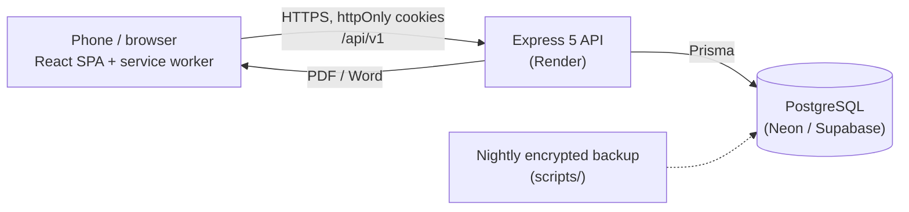

# Hisab Mezgeb (ሒሳብ መዝገብ)

[](https://github.com/Messibre/HisabMezgeb/actions/workflows/backend-ci.yml)
[](https://github.com/Messibre/HisabMezgeb/actions/workflows/frontend-ci.yml)

A daily money and debt book for a small family shop in Ethiopia. It replaces a paper ledger: the evening cash total, shop and family expenses, money put into or taken out of the shop, and who owes the shop what. It works in Amharic, Tigrigna and English, uses the Ethiopian calendar, and installs on a phone like an app.

It is deliberately small. It is not an accounting system, an inventory system or a multi-user SaaS. Two family members share one login.

**Live:** _add the deployed URL here._

> Screenshots: to be added. Use demo data only, never real customers or amounts.

---

## Why it is built this way

| Decision | Reason |
|---|---|
| **Income and debt are two separate systems.** The nightly income is one blended cash figure (sales and debt repayments together, as the cash drawer really is). The debt book tracks who owes what. Neither updates the other. | That is how the shop counts money. Linking them would double-count repayments. A debt payment never writes to income. |
| **Customer balances are always computed**, never stored. | A stored balance can drift from its records; a computed one cannot. |
| **Soft delete only.** Every user table has `deletedAt`; queries filter on it. Re-adding a deleted day revives the old row. | Nothing a user typed is ever lost. |
| **Money is `Decimal(10,2)`** and balances are subtracted as decimals. | No floating-point drift on money. |
| **Cookie sessions.** httpOnly cookies, a 15-minute access token and a sliding 30-day refresh token that rotates on use. | No token is readable by JavaScript. Dad stays logged in while he uses the app daily. |
| **Ethiopian calendar for display and entry.** The database and API stay Gregorian `YYYY-MM-DD`. | People read and write dates in the Ethiopian calendar; storage stays simple and sortable. |
| **Honest saving.** Offline, Save is disabled and says why. Every save shows one large confirmation that repeats what was saved. | A wrong "saved" on real money is the worst failure. An offline queue exists in code but waits for idempotency keys (see roadmap). |
| **Phone first.** A bottom tab bar on phones, a sidebar from 1024px. | The users' everyday apps are Facebook, TikTok and WhatsApp, not desktop software. |

The full reasoning is in the spec documents listed in [docs/README.md](docs/README.md).

## Architecture



The service worker caches only the app shell (JS, CSS, fonts, icons). API responses are never cached, so no money data stays on a shared phone after logout.

## Stack

| Backend | Frontend |
|---|---|
| Express 5, TypeScript | Vite, React 19, TypeScript |
| Prisma 7 + PostgreSQL | React Router 7, TanStack Query, Zustand |
| Zod validation | react-hook-form + Zod, Tailwind v4, Radix/shadcn |
| bcrypt, jsonwebtoken (cookies) | react-i18next (am, ti, en) |
| Pino + pino-http (secrets redacted) | vite-plugin-pwa (Workbox) |
| express-rate-limit, Helmet | Vitest + Testing Library + vitest-axe |
| pdfkit, docx (exports) | |

## Run it locally

Prerequisites: Node.js 20+ and Docker (or your own PostgreSQL).

```bash
cd backend
cp .env.example .env
docker compose up -d
npm install
npm run prisma:generate
npm run prisma:migrate
npm run dev
```

```bash
cd frontend
cp .env.example .env
npm install
npm run dev
```

### Environment

| Variable | Where | Meaning |
|---|---|---|
| `DATABASE_URL` | backend | PostgreSQL connection string |
| `JWT_ACCESS_SECRET`, `JWT_REFRESH_SECRET` | backend | Two different random strings, 32+ characters in production |
| `JWT_ACCESS_EXPIRES_IN`, `JWT_REFRESH_EXPIRES_IN` | backend | Default `15m` and `30d` |
| `CLIENT_URL` | backend | Exact frontend origin for CORS (`http://localhost:5173` locally, one `https://` origin in production) |
| `BCRYPT_SALT_ROUNDS` | backend | Default 10; 12 is a good production value |
| `VITE_API_URL` | frontend | API base, e.g. `http://localhost:3000/api/v1` |
| `VITE_SITE_URL` | frontend | Public site URL for canonical and link-preview tags |

The backend logs `UNSAFE PRODUCTION CONFIGURATION` at start-up if the production CORS origin or JWT secrets are unsafe.

## Test and build

| | Backend | Frontend |
|---|---|---|
| Tests | `npm test` | `npm test` (use `npx vitest run --pool=forks` on slow Windows machines) |
| Build | `npm run build` | `npm run build` |
| Lint | `npm run lint` | `npm run lint` |

The suites include permanent checks for things that matter with real money: re-adding a deleted day, concurrent payments, log redaction, rate limits, refresh-call counts, money sign rules, translation key parity, an "English leak" scan of every screen in Amharic and Tigrigna, and the Ethiopian calendar against `Intl` for every day from 1990 to 2100.

## Security notes

- Session cookies are `HttpOnly`, `Secure` and `SameSite=None` in production, scoped to `/api/v1`. No token is stored in JavaScript storage.
- Refresh tokens rotate on every use. The previous token is accepted for 30 seconds (parallel tabs); older revoked tokens are rejected and logged.
- Rate limits: login and register per IP and phone number, refresh separately, the rest per account (or per IP when signed out). `/health` is not limited.
- Payments run in a transaction that locks the customer row, so two payments cannot overpay a balance.
- Logs redact cookies, authorization headers and password fields.
- Full audit: [docs/security-and-data-audit.md](docs/security-and-data-audit.md). Backups and restores: [backend/docs/backup-and-restore.md](backend/docs/backup-and-restore.md).

## Roadmap

- Schedule and verify the nightly database backup in production. Schema changes wait for this.
- Idempotency keys for borrow, payment and funding entries, then connect the existing offline queue so entries made offline are sent when the phone is back online.
- `ExpenseCategory.systemKey`, replacing the name match used to translate seeded categories.
- `onDelete: Restrict` on money tables.
- Native review of the Amharic and Tigrigna wording ([docs/translation-review.md](docs/translation-review.md)).
- Screenshots with demo data; a Capacitor build for Android.

## Deliberately out of scope

Item-level inventory, roles and permissions, any automatic link between income and debt repayments, multi-currency, and multi-device conflict resolution. If a request points back toward one of these, discuss it before building it.

## License

Not chosen yet.
